# dalibor.net launcher

[](https://github.com/darkobg79/dalibor-tv-launcher/releases)
[](https://github.com/darkobg79/dalibor-tv-launcher/releases/latest)
[](https://github.com/darkobg79/dalibor-tv-launcher/releases/latest)


A clean, Apple TV inspired home screen for Android TV boxes. No ads, no account, no tracking.

**English** · [Srpski](README.sr.md)

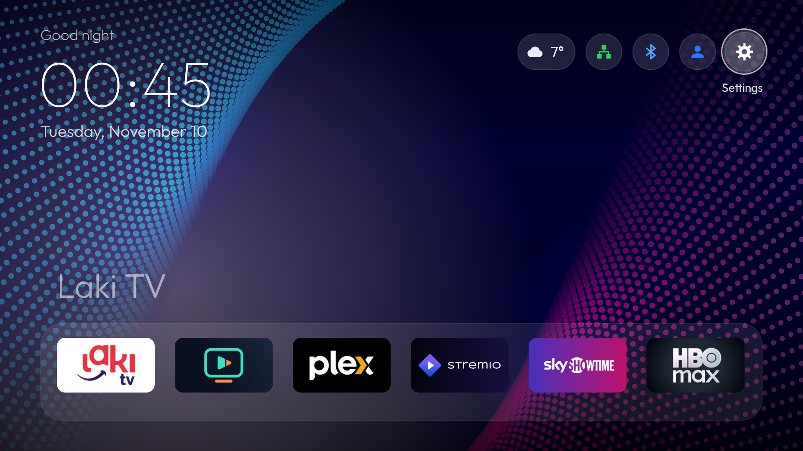

> The interface is available in English and Serbian.
> Tested on an Amlogic S905X3 box running Android TV 9. Other devices may work, but have not been tested.

## Features

### Home screen
- Large clock, date and time-of-day greeting
- Dock with 6 favorite apps, freely replaceable and reorderable
- Preview row above the dock, showing content published by the focused app
- Continue Watching row, with the option to remove individual items
- Status icons: weather, network, Bluetooth, active profile and settings
- Network icon shows LAN or Wi-Fi and turns green when connected; Bluetooth turns blue when a device is connected
- Optional system stats: RAM, CPU, temperature and network speed, with a selectable unit (auto, KB/s, MB/s, Mbit/s)

### All apps
- Grid of every installed app, using TV banners where available
- Sort alphabetically, by most used, or manually
- Move mode that inserts a tile and shifts the others
- Hide apps and restore them from a dedicated tile
- Long-press OK for the app menu: open, move, replace or add to dock, hide, info, uninstall

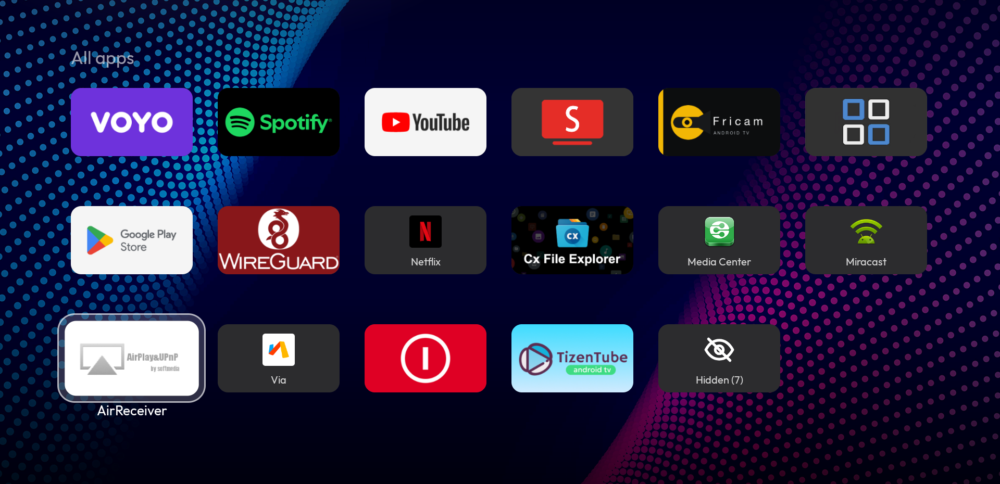

### Weather
- Current conditions, next 24 hours and 7-day forecast
- Selectable city and three card styles
- Data from [Open-Meteo](https://open-meteo.com/), with no account or API key

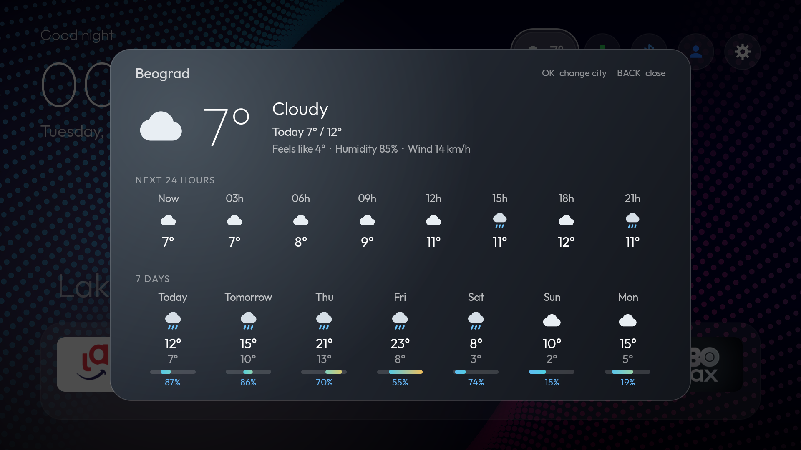

### Profiles
- Local profiles such as "Mine", "Family" or "Kids"
- Each profile has its own dock, app order, hidden apps and theme
- Eight colored profile icons, always visible on the home screen
- These are launcher profiles only: they are not Android users and do not separate accounts inside apps

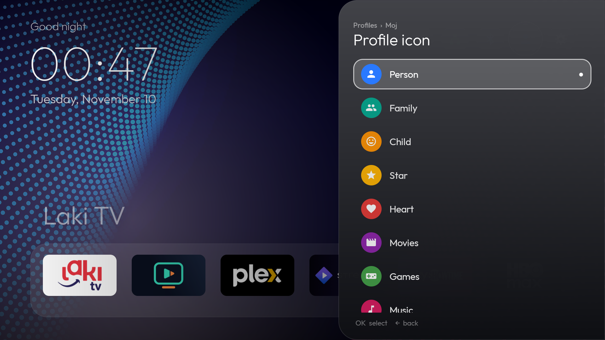

### PIN lock
- One PIN of 4 to 8 digits for the whole launcher, set in Profiles → PIN lock
- **Locked profile**: while this profile is active, Settings, the app menu, profile change, network, Bluetooth and hidden apps ask for the PIN. Handy for a "Kids" profile
- **PIN to enter**: asks for the PIN when this profile is chosen
- The PIN window shows which profile it is asked for
- After the correct PIN the launcher stays unlocked for 5 minutes, or until an app is opened
- Five wrong attempts pause input for 30 seconds
- The PIN is stored only as a salted hash and is never included in backups. If it is forgotten, clear the launcher data and restore a backup

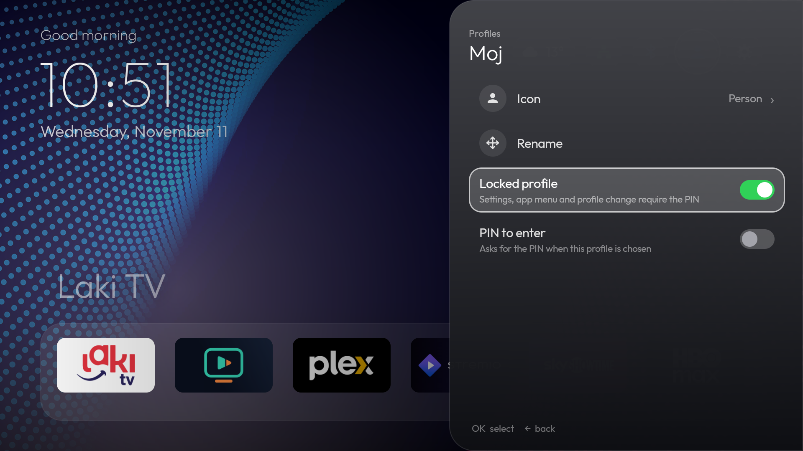

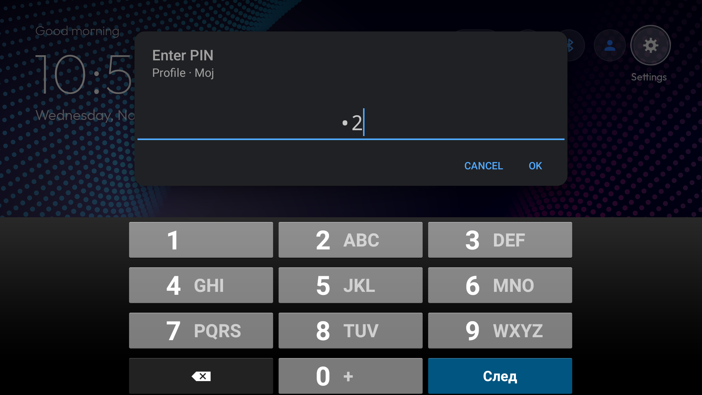

### Backup and restore
- One-click export of the whole configuration to a ZIP file, including the current wallpaper
- Restore from internal storage or USB
- Shows which apps are missing on the device before restoring; they are simply left out of the dock
- The current state is saved automatically before every restore or reset
- Save to a USB drive, directly from the menu
- Automatic daily backup when the configuration has changed, keeping the last 5, also copied to USB when one is inserted
- Reset to defaults

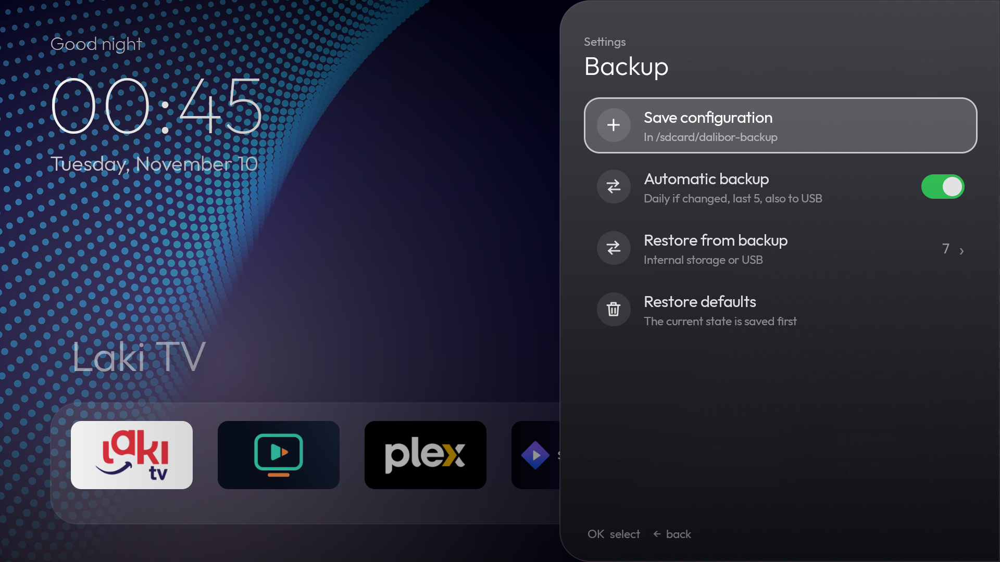

### Updates
- A dedicated menu in Settings, also reachable from About launcher in the System menu
- The installed version is always shown next to the update check
- Checks GitHub Releases for new versions, manually or automatically once a day
- What's new: the list of changes from the latest release notes
- A new APK is verified by SHA-256 and signature, and installed only after you confirm it

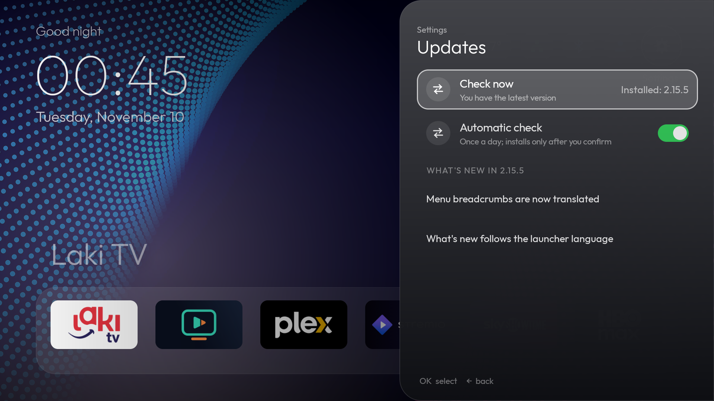

### Look and feel
- Solid and gradient themes, or your own wallpapers from `/sdcard/Pictures/Pozadine`
- Automatic day and night themes with selectable hours; a manually chosen theme stays until the next change
- Built-in screensaver with clock, weather and rotating wallpapers
- Side panel menus with sections, breadcrumbs, icons and switches

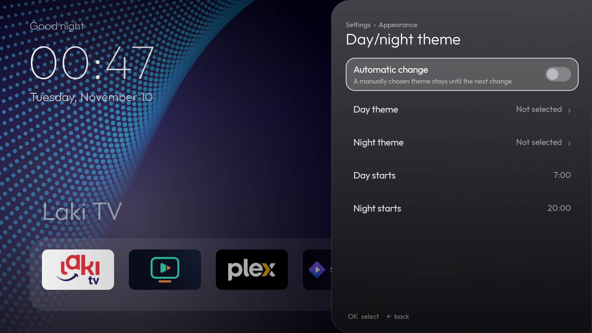

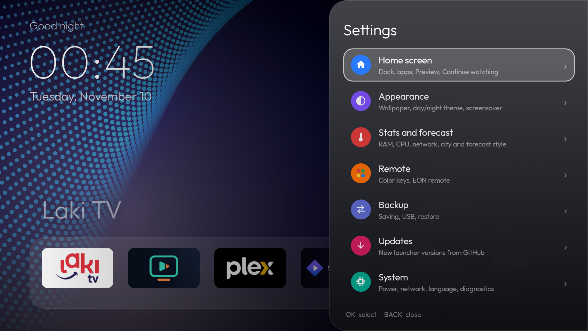

### System
- English and Serbian interface, following the Android language or chosen manually
- Sleep timer, sleep now and restart
- Shortcuts to network and Android settings
- Choose the default launcher, even on firmware that does not offer this option
- Bluetooth menu with quick pairing
- Launcher version and firmware name in the System menu
- Diagnostics screen: firmware, uptime, memory, storage, temperature, network, Bluetooth, USB and permissions
- Keeps paired Bluetooth LE remotes connected, for boxes whose Bluetooth chip does not reconnect them on its own
- Configurable color keys and special remote keys (requires the companion service below)

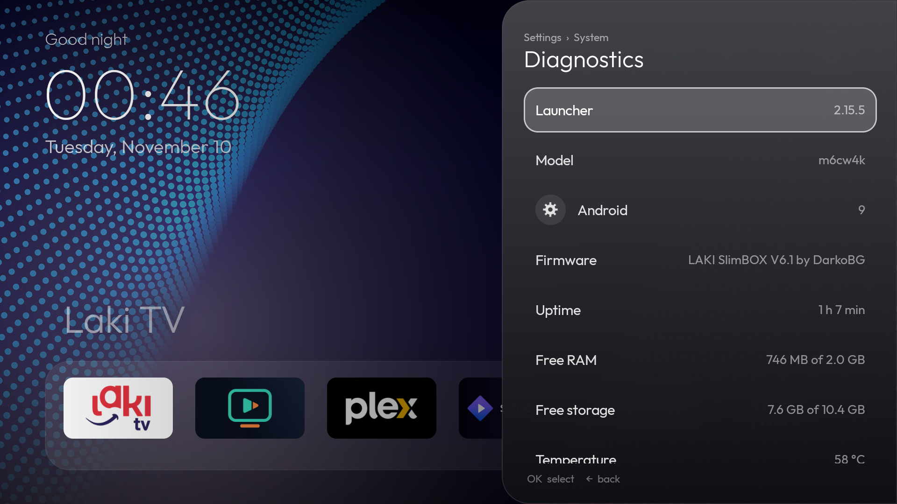

## Settings

| Group | What you will find there |
|---|---|
| **Home screen** | Dock and app order, hidden apps, Preview, Continue watching |
| **Appearance** | Wallpaper, day and night theme, title glow, greeting, screensaver |
| **Stats and forecast** | Stats and how they look, network unit, forecast city and style |
| **Remote** | Color keys, EON remote keys |
| **Backup** | Save to internal storage or USB, automatic backup, restore |
| **Updates** | Installed version, update check, automatic check, what is new |
| **System** | Power, network, language, default launcher, Android settings, diagnostics, firmware name |

Profiles have their own icon on the home screen, next to Settings. The PIN lock is set there as well.

## Installation

```bash
adb install dalibor-home.apk
adb shell cmd package set-home-activity net.dalibor.home/.MainActivity
```

Installed this way, the launcher works as a normal app. Some features need more:

| Feature | Requirement |
|---|---|
| Preview row with content from all apps | Installed in `/system/priv-app` with `ACCESS_ALL_EPG_DATA` |
| Restart and screensaver selection | Installed in `/system/priv-app` with `REBOOT` and `WRITE_SECURE_SETTINGS` |
| Saving to USB | Installed in `/system/priv-app` with `WRITE_MEDIA_STORAGE` |
| Installing updates without a system prompt | Installed in `/system/priv-app` with `INSTALL_PACKAGES` |
| Sleep now and sleep timer | `adb shell dpm set-active-admin net.dalibor.home/.SleepAdmin` |
| Color keys and special remote keys | A root key service on the box, which is not part of this APK |

## Remote control

| Key | Action |
|---|---|
| Arrows | Move focus |
| OK | Open |
| Long-press OK | App menu |
| Back | Return to the dock, or go back in a menu |

## Privacy

The launcher has no ads, analytics or account. Its only network traffic is the weather forecast request to Open-Meteo and the daily update check against GitHub. Backups stay on your device or USB drive.

## License

Free to use and to share unmodified. All rights reserved, see [LICENSE](LICENSE).

## Credits

- [Outfit](https://fonts.google.com/specimen/Outfit) typeface, SIL Open Font License
- Weather data by [Open-Meteo](https://open-meteo.com/)

App names and logos visible in the screenshots belong to their respective owners.
