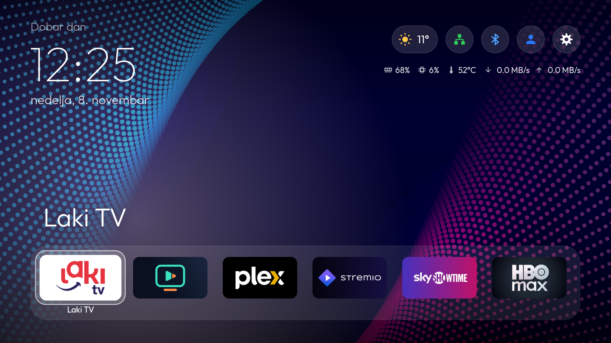
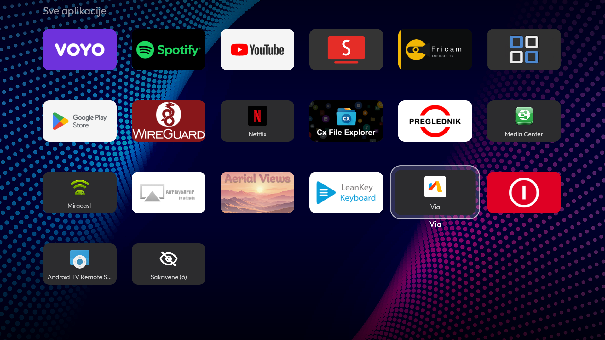
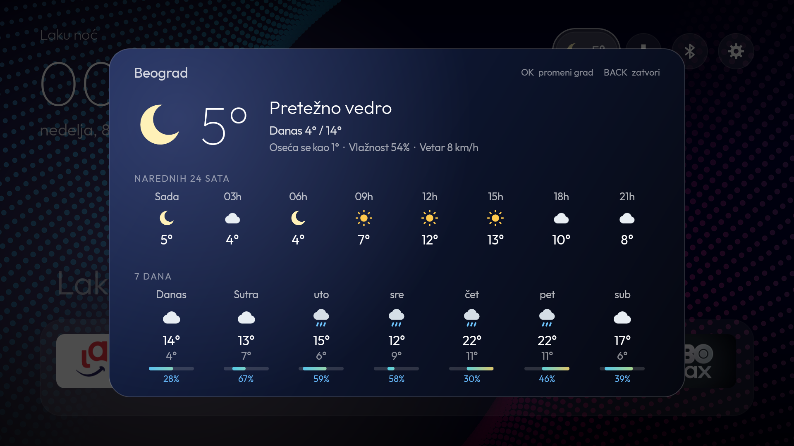
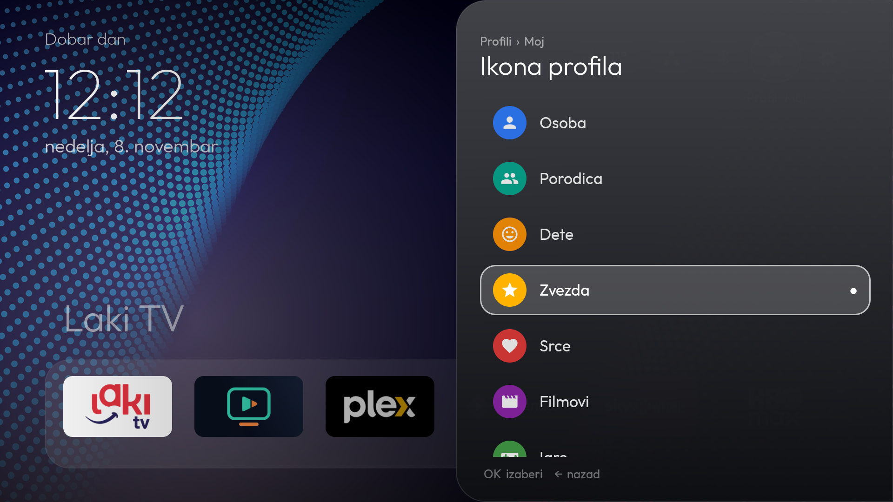
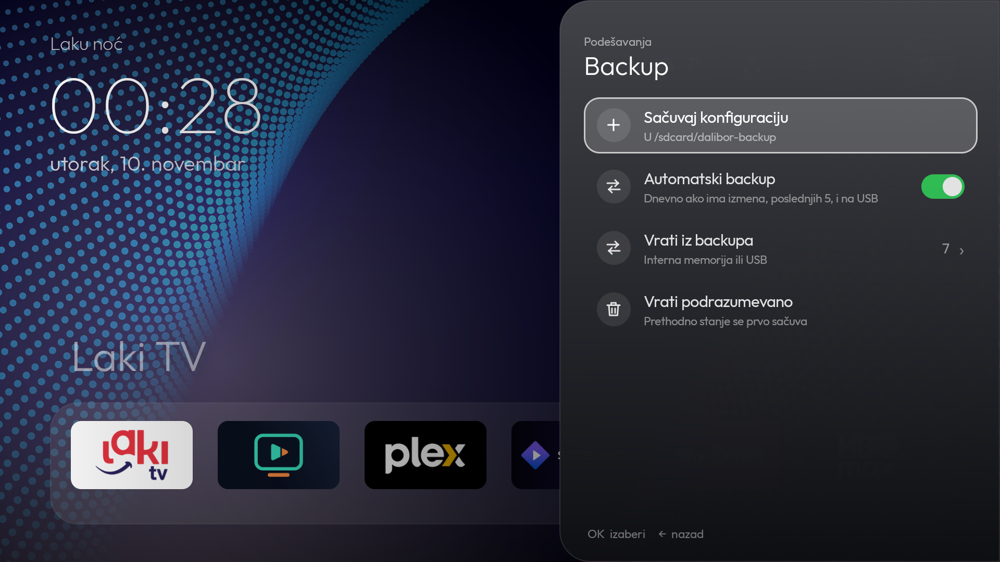
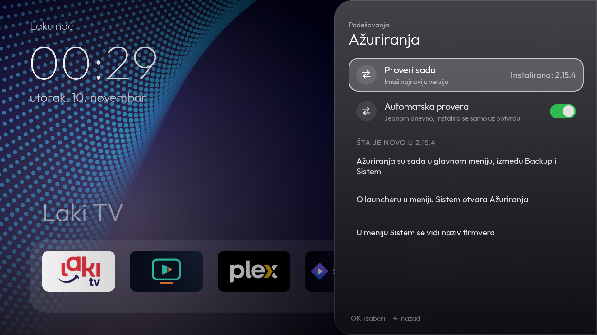
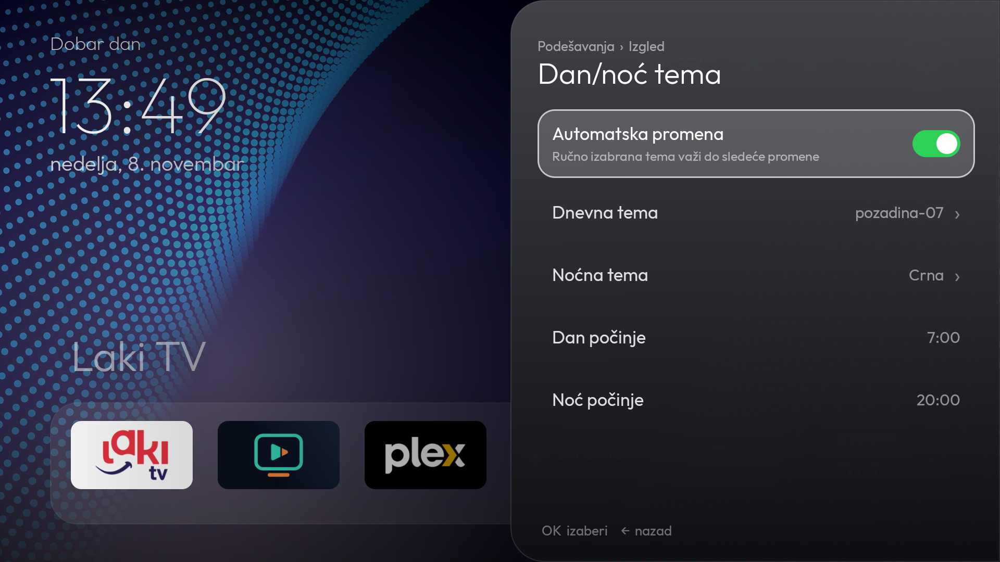
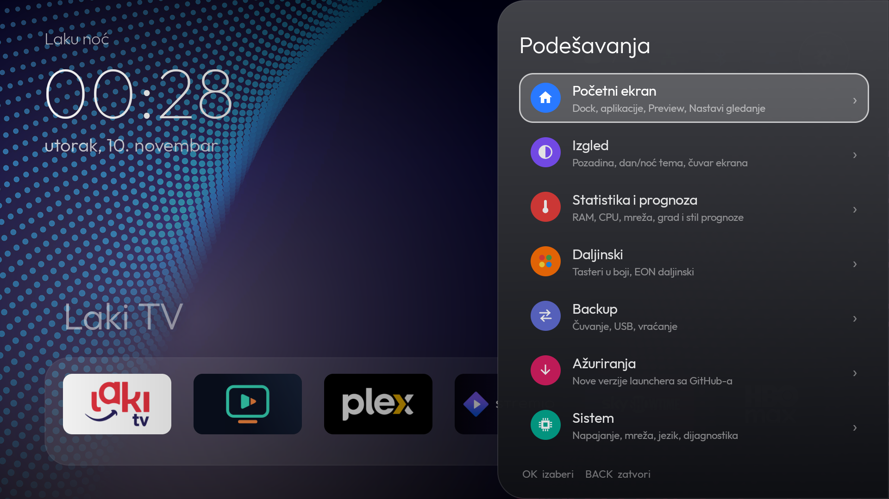
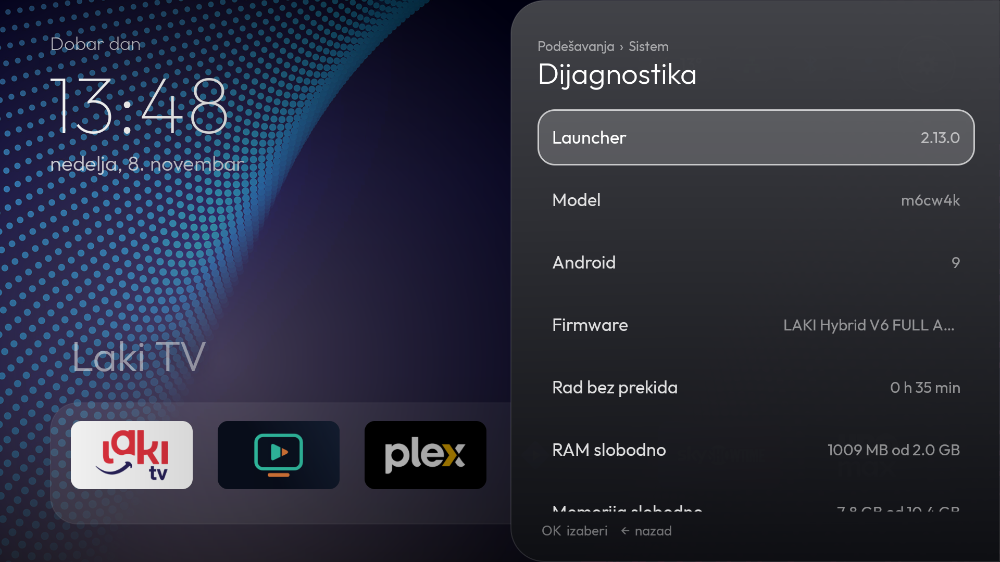

# dalibor.net launcher

Čist početni ekran za Android TV boxove, u stilu Apple TV-a. Bez reklama, naloga i praćenja.

[English](README.md) · **Srpski**



> Interfejs je dostupan na srpskom i engleskom.
> Testirano na Amlogic S905X3 boxu sa Android TV 9. Na drugim uređajima može da radi, ali nije provereno.

## Mogućnosti

### Početni ekran
- Veliki sat, datum i pozdrav prema dobu dana
- Dock sa 6 omiljenih aplikacija, koje slobodno menjaš i premeštaš
- Preview red iznad docka, sa sadržajem koji objavljuje aplikacija u fokusu
- Red Nastavi gledanje, uz mogućnost uklanjanja pojedinačnih stavki
- Ikone stanja: prognoza, mreža, Bluetooth, aktivni profil i podešavanja
- Ikona mreže prikazuje LAN ili Wi-Fi i zelena je kad je povezano; Bluetooth je plav kad je uređaj povezan
- Statistika po izboru: RAM, CPU, temperatura i brzina mreže, sa izborom jedinice (automatski, KB/s, MB/s, Mbit/s)

### Sve aplikacije
- Mreža svih instaliranih aplikacija, sa TV pločicama gde postoje
- Redosled abecedno, po korišćenju ili ručno
- Režim premeštanja koji umeće pločicu i pomera ostale
- Sakrivanje aplikacija i vraćanje preko posebne pločice
- Držanje OK otvara meni aplikacije: otvori, premesti, zameni ili dodaj u dock, sakrij, informacije, deinstaliraj



### Vremenska prognoza
- Trenutno vreme, naredna 24 sata i 7 dana
- Izbor grada i tri stila kartice
- Podaci sa [Open-Meteo](https://open-meteo.com/) servisa, bez naloga i API ključa



### Profili
- Lokalni profili, npr. „Moj“, „Porodica“ ili „Deca“
- Svaki profil ima svoj dock, raspored, sakrivene aplikacije i temu
- Osam ikona u boji, uvek vidljivih na početnom ekranu
- Profili postoje samo u launcheru: nisu Android korisnici i ne razdvajaju naloge u aplikacijama



### Backup i vraćanje
- Izvoz cele konfiguracije u ZIP jednim klikom, zajedno sa trenutnom pozadinom
- Vraćanje iz interne memorije ili sa USB-a
- Pre vraćanja prikazuje kojih aplikacija nema na uređaju; one samo izostanu iz docka
- Trenutno stanje se samo sačuva pre svakog vraćanja ili reseta
- Čuvanje na USB direktno iz menija
- Automatski dnevni backup kad ima izmena, čuva poslednjih 5 i kopira ih na USB ako je ubačen
- Vraćanje na podrazumevana podešavanja



### Ažuriranja
- Poseban meni u Podešavanjima, a otvara se i preko stavke O launcheru u meniju Sistem
- Instalirana verzija se uvek vidi kod provere
- Provera novih verzija na GitHub Releases, ručno ili automatski jednom dnevno
- Šta je novo: lista promena iz opisa poslednjeg izdanja
- Novi APK se proverava preko SHA-256 i potpisa, a instalira se samo kad potvrdiš



### Izgled
- Jednobojne i prelazne teme ili tvoje slike iz `/sdcard/Pictures/Pozadine`
- Automatska dnevna i noćna tema, sa izborom sati; ručno izabrana tema važi do sledeće promene
- Ugrađen čuvar ekrana sa satom, prognozom i smenom pozadina
- Meniji u bočnom panelu, sa sekcijama, putanjom, ikonama i prekidačima





### Sistem
- Interfejs na srpskom i engleskom, po jeziku Androida ili po izboru
- Tajmer za spavanje, spavanje odmah i restart
- Prečice do mreže i Android podešavanja
- Bluetooth meni sa brzim uparivanjem
- Verzija launchera i naziv firmvera u meniju Sistem
- Dijagnostika: firmware, vreme rada, memorija, temperatura, mreža, Bluetooth, USB i dozvole
- Održava vezu sa uparenim Bluetooth LE daljinskim, za boxove čiji se BT čip sam ne povezuje ponovo
- Tasteri u boji i posebni tasteri daljinskog po izboru (traži prateći servis, vidi ispod)



## Podešavanja

| Grupa | Šta je u njoj |
|---|---|
| **Početni ekran** | Dock i redosled aplikacija, sakrivene aplikacije, Preview, Nastavi gledanje |
| **Izgled** | Pozadina, dnevna i noćna tema, sjaj naslova, pozdrav, čuvar ekrana |
| **Statistika i prognoza** | Statistika i njen prikaz, jedinica mreže, grad i stil prognoze |
| **Daljinski** | Tasteri u boji, tasteri EON daljinskog |
| **Backup** | Čuvanje u internu memoriju ili na USB, automatski backup, vraćanje |
| **Ažuriranja** | Instalirana verzija, provera novih verzija, automatska provera, Šta je novo |
| **Sistem** | Napajanje, mreža, jezik, Android podešavanja, dijagnostika, naziv firmvera |

Profili imaju svoju ikonu na početnom ekranu, pored Podešavanja.

## Instalacija

```bash
adb install dalibor-home.apk
adb shell cmd package set-home-activity net.dalibor.home/.MainActivity
```

Ovako instaliran, launcher radi kao obična aplikacija. Za neke mogućnosti treba još nešto:

| Mogućnost | Uslov |
|---|---|
| Preview red sa sadržajem svih aplikacija | Instalacija u `/system/priv-app` uz `ACCESS_ALL_EPG_DATA` |
| Restart i izbor čuvara ekrana | Instalacija u `/system/priv-app` uz `REBOOT` i `WRITE_SECURE_SETTINGS` |
| Čuvanje na USB | Instalacija u `/system/priv-app` uz `WRITE_MEDIA_STORAGE` |
| Instalacija ažuriranja bez sistemskog prozora | Instalacija u `/system/priv-app` uz `INSTALL_PACKAGES` |
| Spavanje odmah i tajmer | `adb shell dpm set-active-admin net.dalibor.home/.SleepAdmin` |
| Tasteri u boji i posebni tasteri | Root servis za tastere na boxu, koji nije deo ovog APK-a |

## Daljinski

| Taster | Radnja |
|---|---|
| Strelice | Pomeranje fokusa |
| OK | Otvaranje |
| Držanje OK | Meni aplikacije |
| Back | Povratak na dock ili nazad u meniju |

## Privatnost

Launcher nema reklame, analitiku ni nalog. Jedini mrežni saobraćaj je zahtev za prognozu prema Open-Meteo servisu i dnevna provera novih verzija na GitHubu. Backupi ostaju na tvom uređaju ili USB-u.

## Licenca

Besplatno za korišćenje i deljenje u neizmenjenom obliku. Sva prava zadržana, vidi [LICENSE](LICENSE).

## Zasluge

- Font [Outfit](https://fonts.google.com/specimen/Outfit), SIL Open Font License
- Podaci o vremenu: [Open-Meteo](https://open-meteo.com/)

Nazivi i logotipi aplikacija na slikama pripadaju njihovim vlasnicima.
